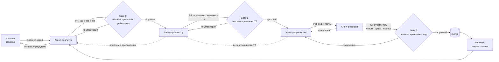

# Пайплайн агентной разработки

Несколько агентов ведут разработку. Человек участвует в четырёх точках:
формулирует хотелки и идеи, принимает PR на требования, принимает PR на
проектное решение, принимает PR на код.



## Роли

| Роль | Тип | Навык | Что делает |
|---|---|---|---|
| Заказчик | человек | — | Формулирует хотелки. Отвечает на интервью и открытые вопросы. Принимает все PR |
| Аналитик | агент | `agent-analyst` | Собирает данные с заказчика интервью раундами, превращает хотелки в BR, FR, TR |
| Архитектор | агент | `agent-architect` | Валидирует требования по DoR, строит проектное решение и ТЗ на инкремент, отвечает на вопросы разработчика |
| Разработчик | агент | `agent-developer` | Реализует ТЗ: код и тесты по навыкам `python-classic-*`. Не додумывает: неоднозначность возвращает архитектору |
| Ревьюер | агент | `agent-reviewer` | Проверяет соответствие ТЗ и навыкам, гоняет CI, пишет отчёт в PR |

## Артефакты

| # | Артефакт | Автор | Потребитель | Шаблон |
|---|---|---|---|---|
| 0 | Хотелки, идеи, контекст | человек | аналитик | свободная форма |
| 1 | BR — бизнес-требования | аналитик | архитектор (контекст, рамки) | [templates/br.md](templates/br.md) |
| 2 | FR — функциональные требования | аналитик | архитектор (основной вход) | [templates/fr.md](templates/fr.md) |
| 3 | TR — технические требования | аналитик | архитектор | [templates/tr.md](templates/tr.md) |
| 4 | Проектное решение | архитектор | человек (Gate 1) | [templates/solution.md](templates/solution.md) |
| 5 | ТЗ на инкремент | архитектор | разработчик | [templates/tz.md](templates/tz.md) |
| 6 | Код + тесты | разработчик | ревьюер, человек (Gate 2) | навыки `python-classic-*` |
| 7 | Отчёт ревьюера | ревьюер | разработчик, человек | комментарий в PR |

Эталон проектного решения и ТЗ: [demo-spec.md](demo-spec.md).

## Общие правила документов

- **Сквозная нумерация требований** (`BR-1`, `FR-12`, `TR-3`, `TZ-NNN`) — для
  трассировки. Ревьюер проверяет: каждый FR покрыт хотя бы одним ТЗ, каждый
  пункт ТЗ покрыт кодом и тестом.
- Раздел **«Открытые вопросы»** обязателен. Агент не додумывает: пишет вопрос
  туда и блокирует пункт до ответа человека.
- Раздел **«Вне рамок»** обязателен. Явно перечислено, что НЕ делается. Это
  главная защита от разрастания кода.
- Все документы хранятся в git и меняются только через PR.
- Документы говорят **«что»**, скиллы `python-classic-*` говорят **«как»**.
  В ТЗ не описываются слои, DI и стиль — они закодированы в скиллах. Чем полнее
  скиллы, тем короче ТЗ.

## Раскладка документов

```
docs/
  requirements/     # вход от человека
    br.md
    fr.md
    tr.md
  design/           # выход архитектора
    solution.md     # проектное решение (живой документ)
    tasks/          # ТЗ на инкременты
      tz-001.md
      tz-002.md
```

## Definition of Ready (DoR)

Агент валидирует вход по чек-листу **до** начала работы. Проверка не пройдена —
возврат автору с конкретным списком пробелов, работа не начинается.

### DoR для архитектора (вход: BR + FR + TR)

- [ ] Каждый FR имеет сценарий или проверяемое правило, а не намерение.
- [ ] Нет противоречий между FR и TR.
- [ ] Все внешние системы из FR описаны в TR (контракт, адрес, авторизация).
- [ ] Указаны права доступа для каждого сценария.
- [ ] «Вне рамок» заполнено.
- [ ] «Открытые вопросы» либо пусты, либо не блокируют первый инкремент.

### DoR для разработчика (вход: ТЗ)

- [ ] Указана трассировка на FR/TR.
- [ ] Каждый usecase описан по схеме: Params, проверки, действия, сигналы, права.
- [ ] Есть контракты: эндпоинты, коды ответов, форматы.
- [ ] Есть изменения хранилища: таблицы, миграции.
- [ ] Критерии приёмки проверяемы тестом (Given/When/Then или список кейсов).
- [ ] «Открытые вопросы» пусты или помечены неблокирующими.

## Definition of Done (DoD)

### DoD проектного решения + ТЗ (Gate 1)

- [ ] Каждый FR инкремента покрыт пунктом ТЗ, трассировка указана.
- [ ] Модель предметной области: агрегаты, поля, инварианты, критерии.
- [ ] Критерии приёмки покрывают успех, ошибки валидации и доменные ошибки.

### DoD кода (Gate 2)

- [ ] Код следует скиллам `python-classic-*` (проверяет ревьюер).
- [ ] CI зелёный: `pyright` (strict), `ruff` (ALL), `vulture`, `pytest`.
- [ ] Мутационное тестирование по скиллу `python-classic-mutation-testing`
  для нового app-кода.
- [ ] Каждый критерий приёмки из ТЗ покрыт тестом.
- [ ] Новые требования, найденные в работе, вынесены в «Открытые вопросы»
  ТЗ, а не реализованы молча.

## Обратная связь разработчик → архитектор

Когда ТЗ неоднозначно, разработчик не выбирает решение сам. Он:

1. Пишет вопрос в раздел «Открытые вопросы» ТЗ.
2. Помечает соответствующий пункт как blocked, реализует остальное.
3. Если блокировка критична — останавливается и возвращает ТЗ архитектору
   комментарием в PR или issue.

Архитектор отвечает правкой ТЗ отдельным коммитом в тот же PR или новым PR
на документ, если решение меняет проектное решение.
